# Awesome ASGI Web Frameworks ⚡🚀

  

  
  
  
  
  
  

---

## 🌟 Top ASGI Web Frameworks Ecosystem

**Curated List of SaaS Products & Open-Source GitHub Projects for High-Performance Python Web Applications** 🐍⚡  
*Focused on Async Python APIs, Type-Safe Routing, High-Concurrency Microservices & Production Runtimes*  
**Last updated: October 2026** 📅

This repository tracks notable **SaaS platforms** and **open-source projects** in the **ASGI (Asynchronous Server Gateway Interface)** ecosystem. These modern tools enable Python developers to build async-first, event-driven web applications—ranging from ultra-fast micro-frameworks with granular routing control to enterprise platforms featuring automatic OpenAPI 3.1 documentation, dependency injection, and Pydantic/msgspec data validation. 🚀

**Category leaders and standout solutions** include FastAPI, Django, Django REST Framework, Sanic, Starlette, Litestar, Falcon, Robyn, Quart, Granian, and Uvicorn.

---

## 📑 Table of Contents
- [📊 Sector Overview & Market Dynamics](#-sector-overview--market-dynamics)
- [☁️ SaaS/Hosted Platforms](#️-saashosted-platforms)
- [🐙 Open-Source GitHub Projects](#-open-source-github-projects)
  - [⚡ Top ASGI & Async Python Frameworks](#-top-asgi--async-python-frameworks)
  - [🏎️ ASGI High-Performance Servers](#️-asgi-high-performance-servers)
  - [🛠️ Async Toolkits, ORMs & Utilities](#️-async-toolkits-orms--utilities)
- [🤝 How to Contribute](#-how-to-contribute)
- [☕ Support & Community](#-support--community)
- [📈 Star History](#-star-history)
- [⚠️ Disclaimer](#️-disclaimer)

---

## 📊 Sector Overview & Market Dynamics

The global Platform-as-a-Service (PaaS) and cloud application runtime market is estimated at **$90B–$174B in 2026**, compounding at over **17% CAGR** fueled by the proliferation of cloud-native microservices, serverless APIs, and AI inference backends. 📈

The sector exhibits a **hybrid structure with a concentrated core and a fragmented periphery**: the underlying infrastructure and general compute layer are oligopolistically dominated by hyperscalers (AWS, Azure, GCP, Salesforce), while the developer-facing application PaaS layer remains **moderately fragmented**, leaving ample room for specialized, developer-first platforms (such as Render, Railway, Fly.io, and framework-tailored clouds like FastAPI Cloud) to win significant market share through superior developer experience and zero-config workflows. 🌐💡

---

## ☁️ SaaS/Hosted Platforms

*Ranked by company size (Valuation / Capital Raised / Revenue scale in descending order).* 🏢💰

| Platform | Description | Scale (Valuation / Raised / Revenue) | Starting Pricing | Free Tier Limits |
| --- | --- | --- | --- | --- |
| **[Heroku](https://www.heroku.com/)** | Managed container-based cloud PaaS supporting Python/ASGI workloads via Procfile and custom buildpacks. | **$212M acquisition** (Division of Salesforce; parent revenue $38B+) | $5/month (Eco Dynos share a 1,000-hour monthly dyno pool; apps sleep after 30 mins inactivity) | No free tier or public trial (discontinued in Nov 2022); verified students receive $13/month in GitHub Student Developer Pack credits for 24 months ($312 total) |
| **[Render](https://render.com/)** | Cloud Application Platform offering automated zero-downtime builds and deployments for ASGI/WSGI applications (FastAPI, Litestar, Starlette, Django). | **$1.5B valuation** ($258M total funding, Series C; 100%+ YoY revenue growth) | $7/month (Starter instance, 0.5 CPU, 512 MB RAM; $0/month Hobby workspace) | Free forever (Hobby Web Service): 750 instance hours/month, 512 MB RAM, spins down after 15 minutes of inactivity; 5 GB outbound bandwidth/month; Free PostgreSQL expires after 30 days (1 GB) |
| **[Fly.io](https://fly.io/)** | Global application execution platform running ASGI servers close to users via lightweight Firecracker microVMs. | **~$475M valuation** (~$135M total funding through Series D) | ~$2.19/month (`shared-cpu-1x`, 256 MB RAM continuous baseline; pay-as-you-go) | Free trial only: 2 hours total Machine runtime or 7 calendar days (whichever expires first), no credit card required upfront; no permanent free compute tier |
| **[Railway](https://railway.com/)** | Modern developer cloud platform for deploying async Python APIs, worker services, and databases with instant GitHub syncing. | **~$124M funding raised** ($100M Series B in 2026; private valuation undisclosed) | $5/month (Hobby plan base with $5 included usage credit; compute billed per second at ~$10/GB-mo RAM & ~$20/vCPU-mo) | Free forever (Free Plan): $1/month included usage credit, 1 active project, 1 vCPU, 512 MB RAM, 1 replica, 3-day log retention (or 30-day trial with $5 one-time credit) |
| **[Koyeb](https://koyeb.com/)** | Serverless developer engine designed for high-performance Python APIs, full-stack apps, and AI microservices with global edge routing. | **Acquired by Mistral AI** ($8.6M prior funding raised; backed by Serena & Samsung Next) | $29/month (Pro plan base with $10 compute credit included) | Free forever: 1 Eco/Free instance (0.1 vCPU, 512 MB RAM, 2 GB SSD), single region, spins down to sleep after 1 hour of inactivity |
| **[FastAPI Cloud](https://fastapicloud.com/)** | Official managed deployment platform tailored for FastAPI applications by Sebastián Ramírez (*tiangolo*) and core maintainers. | **$4.2M seed round** (Led by Sequoia Capital; private valuation undisclosed) | $20/seat/month (Pro plan; beta flat per-seat pricing before compute metering) | Free forever (Hobby Plan): 0.1 vCPU (burst to 0.5), 512 MB RAM, up to 3 apps, 1 custom domain, 2 max replicas, 1-day log/metric retention |

---

## 🐙 Open-Source GitHub Projects

*Ranked strictly by GitHub_Stars_Count (descending).* 🌟

### ⚡ Top ASGI & Async Python Frameworks

- **[FastAPI](https://github.com/fastapi/fastapi)**   
  **The de facto standard for Python backends in 2026** (MIT) • **Core value**: Pydantic-based automatic schema validation, robust Dependency Injection (`Depends`), and automatic interactive Swagger UI / ReDoc generation at `/docs`. Powers millions of high-throughput APIs globally with an expansive ecosystem.

- **[Django](https://github.com/django/django)**   
  **The web framework for perfectionists with deadlines** (BSD-3-Clause) • **Native ASGI support since version 3.0** • Complete web framework featuring an industry-standard ORM, automatic admin interface, authentication, migrations, and unmatched ecosystem maturity.

- **[Django REST Framework](https://github.com/encode/django-rest-framework)**   
  **The standard toolkit for building Web APIs with Django** (BSD-3-Clause) • Offers class-based views, serializers, browsable API interfaces, authentication schemes, and permissions. Dominates enterprise APIs where Django's admin and ORM accelerate development cycles.

- **[Sanic](https://github.com/sanic-org/sanic)**   
  **Python 3.8+ web server and web framework written to go fast** (MIT) • Built for high concurrency with non-blocking async/await syntax, custom route handlers, built-in TLS, and direct uvloop integration. The original pioneer of async Python web engines.

- **[Starlette](https://github.com/encode/starlette)**   
  **The lightweight ASGI toolkit that shines** (BSD-3-Clause) • **The foundational ASGI toolkit** powering FastAPI and numerous other libraries. Provides high-performance routing, middleware pipelines, test client, session support, CORS, static file serving, and native WebSockets.

- **[Falcon](https://github.com/falconry/falcon)**   
  **The minimalist REST and microservices backend framework** (Apache-2.0) • Uncompromising reliability, correctness, and raw throughput. Native ASGI support since version 3.0 with Cython-optimized internals.

- **[Bottle](https://github.com/bottlepy/bottle)**   
  **Fast, simple, lightweight WSGI/micro web-framework** (MIT) • Distributed as a single-file module with zero dependencies. The simplest entry point for lightweight services and prototypes.

- **[Litestar](https://github.com/litestar-org/litestar)**   
  **High-performance ASGI framework with first-class msgspec support** (MIT) • Features controller class-based routing, DTO pattern separating database schemas from API models, built-in dependency injection plugin system (SQLAlchemy, Redis, SAQ), OpenAPI 3.1 compliance, and 1.2M+ req/sec on TechEmpower benchmarks.

- **[Robyn](https://github.com/sparckles/Robyn)**   
  **Fast, community-driven async Python web framework with a Rust runtime** (BSD-2-Clause) • Combines Python developer ergonomics with Rust-powered multi-threaded event loop execution for extreme throughput and minimal memory footprint.

- **[Channels](https://github.com/django/channels)**   
  **Asynchronous event layer for Django** (BSD-3-Clause) • The original project that drove the ASGI specification. Extends Django across WebSockets, chat protocols, IoT events, and long-polling background connections.

- **[Pyramid](https://github.com/Pylons/pyramid)**   
  **The down-to-earth, start-small finish-big framework** (BSD-3-Clause) • Supports WSGI and ASGI adapters. Completely unopinionated architecture designed to scale gracefully from single-file scripts to large enterprise applications.

- **[Quart](https://github.com/pallets/quart)**   
  **ASGI web microframework whose API is a drop-in superset of Flask** (MIT) • Supports HTTP/1.1, HTTP/2 server push, WebSockets, and Server-Sent Events (SSE). The seamless async migration path for Flask codebases.

- **[BlackSheep](https://github.com/Neoteroi/BlackSheep)**   
  **Fast ASGI web framework inspired by Flask and ASP.NET Core** (MIT) • Built on Cython and uvloop, offering built-in dependency injection, automatic OpenAPI documentation, and rich routing decorators.

- **[Socketify.py](https://github.com/cirospaciari/socketify.py)**   
  **High-performance Python web and WebSocket framework powered by uWebSockets** (Apache-2.0) • Unlocks C++ level networking speed in Python with native ASGI 3.0 and WSGI support.

- **[Emmett](https://github.com/emmett-framework/emmett)**   
  **The web framework designed for developer productivity** (BSD-3-Clause) • Clean syntax, seamless async routing, integrated ORM, auth tools, and first-party compatibility with the Granian HTTP server.

---

### 🏎️ ASGI High-Performance Servers

- **[Uvicorn](https://github.com/encode/uvicorn)**   
  **The lightning-fast ASGI server implementation** (BSD-3-Clause) • Powered by `uvloop` and `httptools`. The default ASGI server recommended for FastAPI, Starlette, and modern Python deployments.

- **[Granian](https://github.com/emmett-framework/granian)**   
  **Ultra-fast HTTP server for Python applications written in Rust** (BSD-3-Clause) • Multi-threaded Rust runtime supporting ASGI, RSGI, and WSGI interfaces. Delivers 1.5× to 2× the throughput of traditional C/Python servers.

- **[Hypercorn](https://github.com/pgjones/hypercorn)**   
  **ASGI and WSGI web server based on Hyper libraries** (MIT) • First-class support for HTTP/1.1, HTTP/2, HTTP/3 (QUIC), WebSockets, and alternative async event loops including Trio and asyncio.

---

### 🛠️ Async Toolkits, ORMs & Utilities

- **[Tortoise ORM](https://github.com/tortoise/tortoise-orm)**   
  **Familiar asyncio ORM inspired by Django** (Apache-2.0) • Easy-to-use async relational database layer supporting PostgreSQL, MySQL, and SQLite with built-in schema generation and relationship prefetching.

- **[Databases](https://github.com/encode/databases)**   
  **Async database support for Python with SQLAlchemy core expressions** (BSD-3-Clause) • Simple, non-blocking connection pool manager designed for Starlette and FastAPI backends.

- **[Mangum](https://github.com/Kludex/mangum)**   
  **Serverless ASGI adapter for AWS Lambda and API Gateway** (MIT) • Run FastAPI, Starlette, Quart, and any ASGI application in serverless Lambda functions with zero infrastructure hassle.

- **[Piccolo](https://github.com/piccolo-orm/piccolo)**   
  **Fast, user-friendly async ORM and query builder** (MIT) • Bundles an ASGI web admin dashboard, schema migration engine, and full type annotations for PostgreSQL and SQLite.

- **[asgi-lifespan](https://github.com/florimondmanca/asgi-lifespan)**   
  **Programmatic startup/shutdown client for ASGI applications** (MIT) • Enables programmatic lifecycle event triggering during integration tests without spawning a live network server.

---

## 🤝 How to Contribute

Contributions are welcome and highly appreciated! 💖

1. Fork this repository 🍴
2. Create a new branch: `git checkout -b feature/awesome-entry`
3. Add or edit entries in `README.md` following the existing format (include repo link, Stars_Badge, license, and factual description) 📝
4. Verify all markdown links and ensure proper categorization 🔍
5. Commit your changes: `git commit -m 'Add new ASGI framework or tool'`
6. Push to your branch and open a Pull Request! 🎉

---

## ☕ Support & Community

If you find this curated list valuable for your projects or career, please consider showing your support:

- ⭐ **Star this repository** to help others discover high-performance async Python tools!
- 🍴 **Fork and share** with your teammates and community.
- 💬 **Join our community** on [Discord](https://discord.gg/jc4xtF58Ve) to discuss async architectures.
- ☕ **Buy me a coffee / Sponsor**: If you'd like to support ongoing maintenance and new developer resources, please consider sponsoring via the [GitHub Sponsor Dashboard](https://github.com/sponsors/ishandutta2007)! 💖

---

## 📈 Star History

---

## ⚠️ Disclaimer

- This is a **community-curated** list — not exhaustive and not an official commercial endorsement.
- ASGI frameworks handling web traffic must follow security best practices and comply with relevant data protection regulations.
- **ASGI is not automatically faster than WSGI.** What ASGI enables is efficient concurrent handling of I/O-bound workloads—slow downstream calls, WebSockets, SSE, long-lived requests. For CPU-bound or sync-blocking code, ASGI provides no throughput advantage and can cost overhead.
- **The async illusion is real.** Writing `async def` does not make a function non-blocking—it marks it as a coroutine. If the body calls a sync database driver, sync HTTP library, or CPU-bound computation without thread offload, the event loop blocks for every concurrent request.
- **Framework selection is an architectural decision.** Granian as a server provides 1.5–2× throughput over uvicorn regardless of framework. Operational criteria (DI model, controller vs function-based routing, msgspec vs Pydantic) should drive your framework choice.
- **The database is almost always the bottleneck.** Query plans, N+1 query patterns, indexing, and connection pool sizing dominate real-world production performance.

---

  <b>Built for Python developers, API engineers, and platform teams building async-native architectures. ⚡🐍</b>

